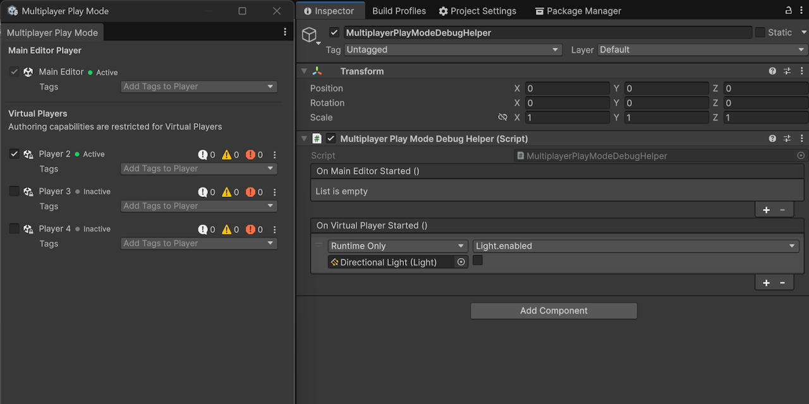

# Unity_MultiplayerPlayModeDebugHelper



Fires events when debugging in Multiplayer Play Mode.

## Importing

You can use Package Manager or import it directly.

```
https://github.com/XJINE/Unity_MultiplayerPlayModeDebugHelper.git?path=Assets/Packages/MultiplayerPlayModeDebugHelper
```

### Dependencies

This project use following resources.

- [Unity_RemoveOnBuilds](https://github.com/XJINE/Unity_RemoveOnBuilds)